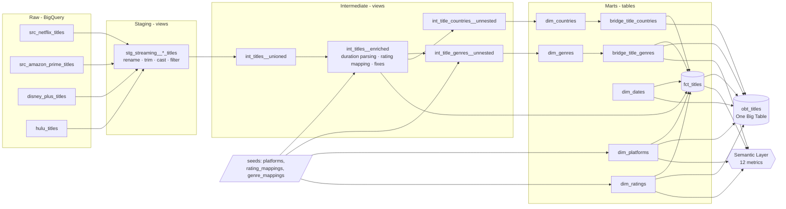

# Streaming Catalog Analytics — dbt project

[](https://github.com/charleschen246/DBT_Stream_Projects/actions/workflows/dbt_ci.yml)

A dbt project that turns the raw title catalogs of **Netflix, Amazon Prime Video, Disney+ and Hulu**
into a tested star schema with a **dbt Semantic Layer** on top, so questions like *"How fast is
each platform growing its catalog?"* or *"Which genres dominate per parent company?"* have one
governed answer.

**Stack:** dbt Core 1.10+ · BigQuery (production) · DuckDB (CI / local) · MetricFlow · GitHub Actions

---

## Architecture



| Layer | Purpose | Materialization | Rule of thumb |
|---|---|---|---|
| **Staging** | One model per source table. Rename, trim, cast, filter. | view | No joins, no business logic |
| **Intermediate** | Business logic: union platforms, parse durations, map ratings, explode lists | view | Reusable building blocks, not exposed to BI |
| **Marts: core** | Star schema: one fact, five dimensions, two bridges | table | Conformed models shared by every domain |
| **Marts: reporting** | `obt_titles`: the star schema flattened into one wide table | table | Plug straight into a BI tool, no joins needed |
| **Semantic** | Metric definitions on top of the marts | — | One definition per metric |

### Star schema

`fct_titles` (grain: **one title on one platform**) → `dim_platforms`, `dim_ratings`, `dim_dates`.
Genres and countries are many-to-many, so they go through `bridge_title_genres` and `bridge_title_countries`.

### One Big Table

`obt_titles` keeps the same grain as `fct_titles` but joins in every dimension and rolls genres and
countries up into sorted, comma-separated lists, so the grain never fans out. Tests check it against
the fact table (row count, counts by platform and content type, runtime totals, genre tags).

| Use the... | When |
|---|---|
| **Semantic layer** | You need a governed metric with one agreed definition (e.g. `movie_share`) |
| **Star schema** | You need genre- or country-level analysis, or are building new marts |
| **OBT** | You're exploring in a BI tool and want every attribute in one place without joins |

---

## Data quality issues found and handled

| Issue in the raw data | Where handled | How |
|---|---|---|
| `show_id` restarts at `s1` on every platform | staging | Surrogate key `title_key = hash(platform_id, show_id)` |
| Duration typed into the rating column (`rating = '74 min'`) | `int_titles__enriched` | Detected and moved back; covered by a unit test |
| Four rating systems (MPA, US TV, Prime's `16+`, aliases `UR`/`UNRATED`/`NOT_RATE`) | `rating_mappings` seed | Mapped to a standard `rating_id` plus a comparable `audience_group` |
| Every platform names genres differently (Netflix `Dramas`, Hulu `Drama`, Disney+ `Action-Adventure`) | `genre_mappings` seed | Each label rolls up to one of ~25 cross-platform `genre_group`s; unmapped labels fall back to `Other` and trigger a warning |
| Amazon's `Arts, Entertainment, and Culture` genre contains commas, so it splits into three bogus labels | `genre_mappings` seed | All three pieces map to the same `Arts & Culture` group |
| Trailing commas and duplicates in list columns (`'France, Belgium, '`) | unnest models | Empty elements filtered, then `distinct` |
| Leading spaces in dates (`' April 4, 2017'`), blank strings | staging | `clean_text()` macro and a lenient date parser |
| `cast` column is a reserved word | staging | Quoted with `adapter.quote()`, renamed to `cast_members` |
| Most Amazon titles have no `date_added` | documented | Kept as NULL; time-based metrics exclude them |

---

## Testing strategy

**159 tests (157 data tests + 2 unit tests) run on every `dbt build`.**

| Type | Examples | Purpose |
|---|---|---|
| **Generic tests** | `unique`, `not_null`, `relationships`, `accepted_values`, `dbt_utils.accepted_range` | Keys, referential integrity, valid values |
| **Custom generic tests** | [`metric_reconciles`](macros/tests/test_metric_reconciles.sql), [`not_blank`](macros/tests/test_not_blank.sql) | Reusable reconciliation and data checks |
| **Reconciliation (stg → marts)** | [`assert_title_metrics_match_from_staging_to_marts`](tests/reconciliation/assert_title_metrics_match_from_staging_to_marts.sql), [`assert_genre_tags_match_from_staging_to_marts`](tests/reconciliation/assert_genre_tags_match_from_staging_to_marts.sql), 12 `metric_reconciles` tests | Prove no row is dropped, duplicated or changed between layers |
| **Business-rule asserts** | movies have minutes and shows have seasons; no future dates; every platform has titles | Domain logic |
| **Unit tests** | duration parsing, misplaced-duration fix | Test SQL logic on hand-written inputs, independent of the data |
| **Warn-level monitors** | `assert_all_source_ratings_are_mapped` | Flags new rating codes without failing the build |

### Reconciliation: how stg and marts are proven to match

`metric_reconciles` is a custom generic test that compares any aggregate between two models, optionally per group:

```yaml
- metric_reconciles:
    name: reconcile_fct_titles_vs_stg_netflix__titles_by_type
    arguments:
      compare_model: ref('stg_streaming__netflix_titles')
      model_filter: "platform_id = 'netflix'"
      group_by: [content_type]
```

The singular reconciliation tests go further. They recompute **title counts, distinct IDs, a release-year
checksum and dated-title counts** directly from the four staging models, without going through the
intermediate layer, and compare them with the marts per platform and content type. A failure returns the
exact platform and content type that diverged, and `store_failures` keeps those rows in the warehouse for
debugging.

---

## Semantic layer

Defined in [`models/semantic/sem_streaming.yml`](models/semantic/sem_streaming.yml): 4 semantic models and 12 metrics.

| Metric | Type | Description |
|---|---|---|
| `total_titles`, `movies`, `tv_shows` | simple | Catalog size |
| `movie_share` | ratio | Movies ÷ all titles |
| `avg_movie_runtime_minutes`, `avg_seasons_per_show` | simple | Content depth |
| `avg_years_from_release_to_platform` | simple | How old titles are when a platform adds them |
| `titles_added` | simple | Additions over time (use `metric_time`) |
| `cumulative_titles_added` | cumulative | Catalog size over time |
| `titles_added_yoy_growth` | derived | Year-over-year change using `offset_window` |
| `genre_tagged_titles` | simple | Titles per genre |

```bash
# Catalog mix per platform
mf query --metrics total_titles,movie_share,avg_movie_runtime_minutes --group-by platform__platform_name

# Catalog growth per year, per platform
mf query --metrics titles_added,cumulative_titles_added --group-by metric_time__year,platform__platform_name

# Audience mix across rating systems
mf query --metrics total_titles --group-by rating__audience_group,platform__platform_name

# Top genres per parent company
mf query --metrics genre_tagged_titles --group-by title_genre__genre_name,platform__parent_company --order -genre_tagged_titles --limit 10
```

On dbt Cloud, use `dbt sl query` with the same arguments.

---

## Running the project

### Option A: locally, no warehouse needed (DuckDB)

```bash
python -m venv .venv && source .venv/bin/activate   # Windows: .venv\Scripts\activate
pip install -r requirements.txt
python ci/create_fixture_db.py ci/streaming.duckdb   # small synthetic dataset with the raw data's quirks
export DBT_PROFILES_DIR=ci                          # Windows PowerShell: $env:DBT_PROFILES_DIR="ci"
dbt deps
dbt build --vars '{source_database: streaming}'
mf validate-configs
```

### Option B: BigQuery (full Kaggle data)

1. Load the four CSVs from Kaggle ([Netflix](https://www.kaggle.com/datasets/shivamb/netflix-shows), [Amazon Prime](https://www.kaggle.com/datasets/shivamb/amazon-prime-movies-and-tv-shows), [Disney+](https://www.kaggle.com/datasets/shivamb/disney-movies-and-tv-shows), [Hulu](https://www.kaggle.com/datasets/shivamb/hulu-movies-and-tv-shows)) into a BigQuery dataset.
2. Add a profile to `~/.dbt/profiles.yml`:

   ```yaml
   streaming_analytics:
     target: dev
     outputs:
       dev:
         type: bigquery
         method: oauth               # or service-account with keyfile
         project: <your-gcp-project>
         dataset: dbt_dev
         threads: 4
         location: US
   ```
3. Point the sources at your dataset, either in `dbt_project.yml` vars or on the command line:

   ```bash
   dbt deps
   dbt build --vars '{source_database: <your-gcp-project>, source_schema: <your_dataset>}'
   dbt docs generate && dbt docs serve
   ```

### Warehouse portability

Two warehouse-specific operations, date parsing and splitting lists, live in dispatch macros in
[`macros/cross_db/`](macros/cross_db/), with BigQuery and DuckDB implementations. Everything else uses
dbt's built-in cross-database macros, so the same models run unchanged in production (BigQuery) and in CI (DuckDB).

---

## Project structure

```
├── .github/workflows/dbt_ci.yml     # builds + tests every PR on DuckDB
├── analyses/                        # ad-hoc SQL that uses the marts
├── ci/                              # CI profile + synthetic fixture generator
├── macros/
│   ├── cross_db/                    # BigQuery / DuckDB dispatch macros
│   ├── tests/                       # custom generic tests
│   └── clean_text.sql
├── models/
│   ├── staging/streaming/           # stg_streaming__*  (1:1 with sources)
│   ├── intermediate/                # int_*             (business logic)
│   ├── marts/core/                  # fct_* / dim_* / bridge_*  (conformed star schema)
│   ├── marts/reporting/             # obt_titles                (One Big Table for BI)
│   ├── semantic/                    # semantic models + metrics
│   └── utilities/                   # MetricFlow time spine
├── seeds/                           # platforms, rating_mappings, genre_mappings
└── tests/
    ├── reconciliation/              # stg → marts reconciliation asserts
    └── data_quality/                # business-rule asserts
```

## Governance: contracts and access

| Layer | `access` | Contract | Meaning |
|---|---|---|---|
| Staging | `private` | — | Only models in the `content_analytics` group may use them |
| Intermediate | `protected` | — | Usable inside this project, not by other projects |
| Marts | `public` | **enforced** | The stable interface for BI tools and other dbt projects |

Every mart column declares its `data_type`. If a code change alters a column's name or type, the build
fails before the table is replaced, so downstream dashboards don't break silently:

```
| column_name   | definition_type | contract_type | mismatch_reason    |
| audience_rank | VARCHAR         | BIGINT        | data type mismatch |
```

## Conventions

- Models are prefixed by layer (`stg_`, `int_`, `fct_`, `dim_`, `bridge_`) and staging models are named `stg_<source>__<entity>`.
- Every model starts with import CTEs (`select * from ref(...)`), followed by logical CTEs, and ends with a plain `select * from <last_cte>`.
- Every model has a YAML entry with a description; shared column descriptions use doc blocks ([`models/_docs.md`](models/_docs.md)).
- Primary keys are tested `unique` + `not_null`, and every foreign key has a `relationships` test.
